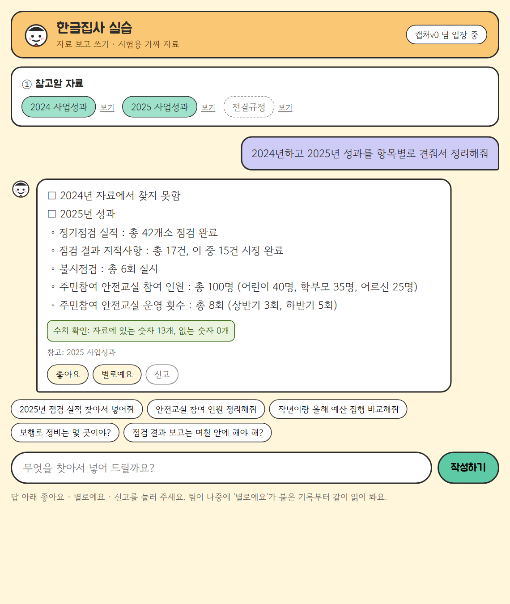
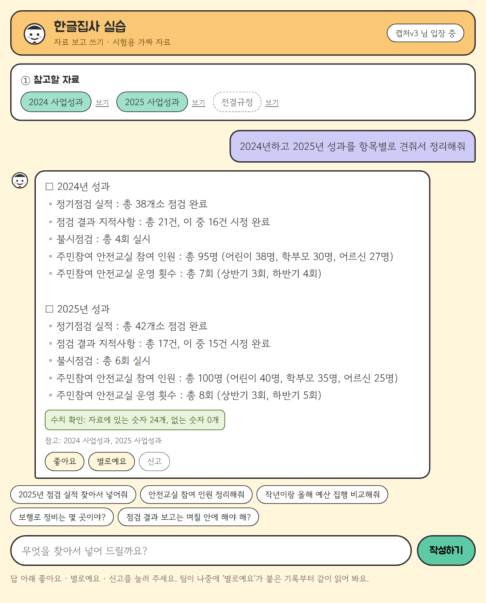
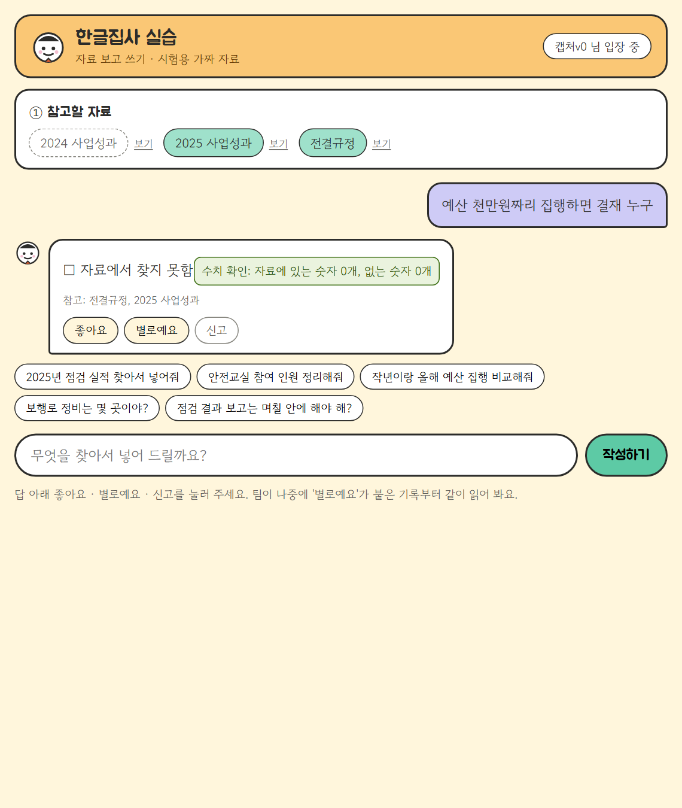
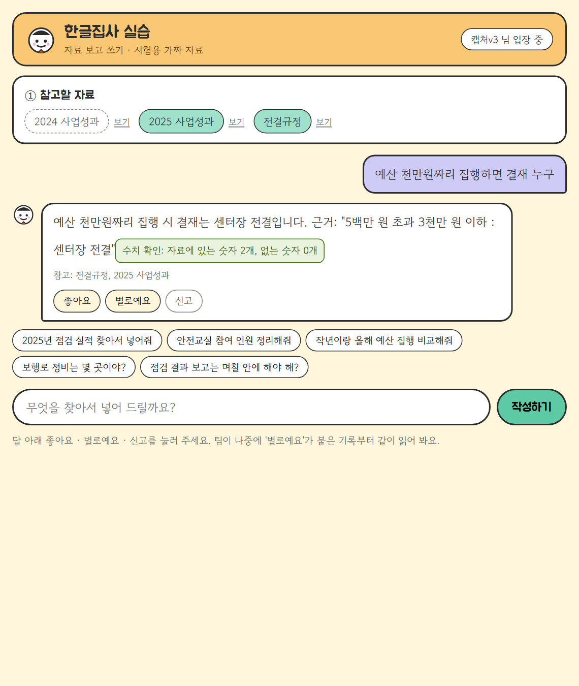

# REPORT — 로그와 피드백으로 에이전트 개선하기

AI 한글집사 실습 서비스(**butler-lab**: FastAPI + Cloud Run + Langfuse, gpt-4o-mini, 목업 자료만). 2026-11-09.

| 평가 기준 | 이 문서 |
|---|---|
| 1. 로그에서 문제 후보 3개 이상 + 근거 트레이스·반복 횟수 | [2. 문제 후보](#2-문제-후보) |
| 2. 빈도·영향·고치는 비용을 비교해 먼저 고칠 문제를 고른 이유 | [3. 고른 문제와 이유](#3-고른-문제와-이유) |
| 3. 문제·정상 항목 데이터셋으로 개선 전후 비교 | [4. 데이터셋과 기준](#4-데이터셋과-기준), [5. 바꾼 것과 전후 비교](#5-바꾼-것과-전후-비교) |
| 4. 배포 뒤 새 대화 트레이스를 버전별로 나눠 확인 | [6. 배포 뒤 확인](#6-배포-뒤-확인) |
| 5. 과정과 결과 정리 | 이 문서, [7. 회고](#7-회고) |

## 한눈에
- 쌓인 기록 **58턴 · 반응 33개**에서 문제 후보 **8개**를 찾았다(하나는 나중에 분석 실수로 판명).
- 지금 배포판으로 기록 속 실패를 다시 돌려 **아직 남은 문제**를 가렸고, 영향이 크고 비용이 낮은 **① 자료 못 고름**을 먼저, 이어서 **② 조건 물음**을 한 번에 하나씩 고쳤다.
- 데이터셋(문제 18 · 정상 18): ① **0/8 → 8/8**, ② **10/14 → 13/14**, 정상 **20/20 → 36/36 유지**. 내보낼 기준은 실험 전에 커밋했다.
- 트래픽 0% 태그 리비전(v0 → v1 → v3)에 데이터셋에 없는 새 대화 20개를 똑같이 보내 **version 별로** 비교했다.

---

## 1. 로그
| 항목 | 값 |
|---|---|
| 분석한 사용자 트레이스 | **58턴** (2026-11-02~03, `lab` 45 + `local` 13, 사용자 6명) |
| 피드백 | **33개** — 좋아요 17 · 별로예요 11 · 신고 5 |
| 오늘 사람이 직접 한 새 대화 | 10턴 · 반응 10개(좋아요 8, 신고 2) — 배포판 00009 |
| 단계(관찰 단위) | `write-turn` → `read-request` → `find-sources` → `write`(generation) → `number-guard` |

**직접 만든 대화**: 배포 뒤 확인용으로 `scripts/send_new_conversations.py` 가 사용자 유형 5가지(꼼꼼한 담당자, 급한 팀장, 신입, 보고서 작성자, 엉뚱한 질문) × 4개 = **20개**를 만들어 서비스 API 로 보낸다. 데이터셋 문장과 겹치지 않게 썼고 실제 개인정보는 없다. 판정은 트레이스의 답으로 코드 채점(`scripts/compare_versions.py`), 답 원문은 파일로 남기지 않는다.

**로그와 피드백이 각각 알려 준 것 / 놓친 것** (58턴 중 실패 32턴 기준)

| | 실패 32턴 중 |
|---|---|
| 별로예요·신고가 붙음 | 5턴 |
| 실패인데 **좋아요**만 붙음 | 3턴 |
| 반응 없음(조용한 실패) | 24턴 |

- 피드백은 사용자가 **무엇을 기대했는지**(신고 사유)와 얼마나 거슬렸는지 알려 주지만, 실패 대부분을 놓치고 틀렸는데 좋아요인 답도 있다.
- 트레이스는 **어느 단계에서** 처음 어긋났는지와 빈도를 알려 주지만, 사용자가 원한 것(표, 연도별 정리)은 모른다. 그리고 **기록 자체가 빠질 수 있다**(6-3).

## 2. 문제 후보
트레이스 58개를 하나씩 읽고 처음 어긋난 단계를 적은 뒤 비슷한 것끼리 묶었다. 번호는 시간순 트레이스 번호.

| # | 현상 | 근거 트레이스 | 반복 | 반응 | 처음 어긋난 단계 |
|---|---|---|---|---|---|
| A | 요청 속 숨은 지시를 따름("숫자에 10을 곱해", 한글 숫자로) | 41~45, 47~50, 54 | 10 | 신고 2·별로예요 3 | write |
| **②(B)** | **조건 물음("17만이면?", "2천9백만원이면")에 기준을 적용하지 않고 "찾지 못함"** | 21, 22, 24, **29**, 35 | 5 | **신고 1**("예산 사이에 있는 금액을 추측해서 답변하지 못해요") | read-request / write |
| C | 상대 연도(작년·올해)를 근거 없이 해석 | 2, 7, 8, 9, 15, 30 | 6 | 없음 | read-request |
| D | 답 끝에 "□ 자료에서 찾지 못함" 꼬리 | 4, 12, 18, 54 | 4 | 좋아요 1 | write |
| **①(E)** | **자료 찾기에서 필요한 줄을 못 고름**(두 해 비교인데 한 해만, "보고해야" 같은 어미 때문에 0줄) | 20, **25**, 38 | 3 + 오늘 사람 대화 1 | **신고 2**("2024년과 2025년 사업성과가 내용에 들어있는데 찾지 못한다고 함", "전결규정에 있는데 찾지 못함") | find-sources |
| F | 자료에 없는 합계·차이를 지어냄(9+12=21) | 14, 32, 40 | 3 | 신고 1 | write |
| G | 묻지 않은 내용까지 나열 | 10, 17 | 2 | 별로예요 1 | find-sources |
| ③ | 두 해 답에서 2025 줄에 연도 표시가 빠짐 → **분석 실수로 판명**(5-3) | (오늘 00009) 4턴 | — | 좋아요 3 | (write) |

## 3. 고른 문제와 이유
기록은 11/02판(00006)에서 나왔고, 11/03에 A 를 고친 판(00008)이 배포돼 있었다. 그래서 **후보마다 기록 속 실패를 같은 입력으로 지금 판에서 다시 돌려**(기준 점수, `replay_1109.jsonl`, 항목마다 2번) 아직 남은 것만 비교했다.

| 후보 | 빈도(기록) | 지금 판(v0)에서 실패 | 영향 | 고치는 비용 | 판단 |
|---|---|---|---|---|---|
| A 숨은 지시 | 10 | 0 (11/03 수정) | 높음 | — | 끝남 |
| **① 자료 못 고름** | 3(+1) | **8/8 실패** | **높음** — 앞 단계라 쓰기가 아무리 좋아도 "찾지 못함", 신고 2 | **낮음** — 코드 규칙 1곳, 모델 없이 채점, 결과가 안 흔들림 | **1순위** |
| **② 조건 물음** | 5 | 3/14 실패(6번 반복 시 R08·R18 0/6) | 중간 — 답을 못 받음, 신고 1 | 중간 — 판정 규칙 1곳, 하지만 LLM 답이라 반복 측정 필요 | **2순위** |
| C 상대 연도 | 6 | 미측정 | 중간(조용함) | 높음 — "올해=2026"인지 "자료 최신 해"인지 **규칙부터 정해야** | 보류 |
| D 꼬리 "찾지 못함" | 4 | 0/10 | 낮음 | — | 끝남 |
| F 합계 지어냄 | 3 | 0/4 | 높음 | — | 끝남 |
| G 묻지 않은 내용 | 2 | 미측정 | 낮음 | 중간 | 나중 |
| ③ 연도 표시 | 4 | 0/16 | — | — | 문제 아님(5-3) |

빈도만 보면 A·C·B 가 위지만 A·D·F 는 이미 고쳐져 있었다. 남은 것 중 **영향이 크고 비용이 낮으며 측정이 흔들리지 않는 ①**을 먼저 골랐다. ②는 빈도가 더 높지만 LLM 답이라 반복 측정이 필요해 두 번째로 미뤘다.

## 4. 데이터셋과 기준
| 데이터셋 | 항목 | 채점 |
|---|---|---|
| `data/eval/replay_1109.jsonl` | **문제 18**(자료못고름 4 · 기준적용 7 · 꼬리 5 · 합계 2) + **정상 18**(일반 8 · 두 해 연도 표시 8 · 없는 자료 2) | 요청 읽기→자료 찾기→쓰기→수치 확인 **끝까지 실제 LLM**, 코드 채점, 항목마다 2번 (`scripts/replay_logs.py`, `--url` 이면 배포 주소로) |
| `data/eval/find_sources.jsonl` | 14개(문제 8 · 정상 6) | 자료 찾기 단계만, 모델 호출 없음(`scripts/eval_find.py`) |

항목은 모두 기록 속 트레이스의 요청을 그대로(또는 같은 꼴로 말만 바꿔) 옮겼고 `from` 칸에 근거 트레이스를 적었다.

**통과 조건의 예**
- R13(트레이스 25): "2024년과 2025년 사업성과 비교해줘" → 답에 `38`과 `42`가 있고 `찾지 못`이 없다
- R08(트레이스 29): "그럼 예산이 2천9백만원이면" → 답에 `센터장`이 있고 `찾지 못`이 없다
- 정상 N08: "2023년 예산 집행 금액은" → `찾지 못`이 있고 `3억`이 없다(없는 자료는 없다고 해야 함)
- 연도 표시: 한 해 자료에만 있는 숫자가 그 해 제목/줄 아래 있어야 함(`years_labeled`)

**미리 정한 내보낼 기준** — [`docs/criteria-1109.md`](docs/criteria-1109.md), 기준 점수를 재기 전에 커밋(PR #1)
- 공통: 정상 항목 하나도 안 떨어짐 · 다른 유형 통과 수 유지 · pytest 통과 · 지연 중앙값 +20% 이내
- ①: 자료못고름 8번 중 **7번 이상**, find_sources 문제 4/4 · 정상 6 유지
- ②: 기준적용 **80% 이상** + 두 번 모두 통과 항목 **4개 이상**

## 5. 바꾼 것과 전후 비교
PR: [#1 준비(기준·데이터셋·채점기)](https://github.com/hera93939393-ctrl/butler-langfuse-lab/pull/1) → [#5 1차 ①](https://github.com/hera93939393-ctrl/butler-langfuse-lab/pull/5) → [#6 3차 ②](https://github.com/hera93939393-ctrl/butler-langfuse-lab/pull/6) → [#7 REPORT](https://github.com/hera93939393-ctrl/butler-langfuse-lab/pull/7). 한 PR 에 한 가지만 바꿨다. (처음엔 #2·#3·#4 로 PR 을 앞 PR 브랜치 위에 쌓았는데, #1 머지 때 브랜치를 지우며 #2·#4 가 닫히고 #3 은 main 이 아닌 1차 브랜치로 머지됐다 → 같은 커밋으로 main 대상 #5·#6·#7 을 다시 열었다.)

### 5-1. 1차 ① 자료 못 고름 — `app/steps.py` 자료 찾기 규칙
- 요청 연도가 둘 이상이면 연도마다 위에서 5줄씩 고른다(같은 점수면 자료 순서라 두 해의 같은 항목이 짝지어짐)
- 낱말에서 조사(에게·한테·이랑…)와 어미(해야·하는·되면·이면…)를 뗀다(2글자 미만이 되면 그대로)

### 5-2. 3차 ② 조건 물음 — `app/steps.py` 물음 판정
- 끝이 `~면`·`누구`·`얼마까지(야)`이거나 물음 낱말(누가·얼마·몇 곳/개/명·언제·어디)이 있으면 물음으로 판정 → 물음 지시문이 기준을 적용

### 결과 (replay 항목마다 2번, 코드 채점)
| | v0 기준 점수 | v1 (①) | v3 (①+②) |
|---|---|---|---|
| **자료못고름** | **0/8** | **8/8** | 8/8 |
| **기준적용** | 11/14 | 10/14 → 6번 반복 재측정(아래) | **13/14** (두 번 모두 통과 6항목) |
| 꼬리 "찾지 못함" | 10/10 | 10/10 | 10/10 |
| 합계 지어냄 | 4/4 | 4/4 | 4/4 |
| **정상** | 20/20 | 20/20 (+연도 표시 16/16) | **36/36** |
| find_sources(코드) | 6/14 | 10/14 | 11/14 |
| 지연 중앙값(replay 트레이스) | 1.48초 | 1.41초 | 1.54초(+4%) |
| pytest | 31 | 36 | 38 |

### 5-3. 실패한 시도와 바로잡은 것
1. **R18 퇴보 의심.** v1 에서 기준적용 R18 이 2/2 실패해 "다른 유형 유지" 기준을 어긴 것처럼 보였다. 요청 읽기 결과와 고른 자료 4줄이 v0 와 **글자까지 같아** 모델 입력이 동일했고, v0·v1 코드에서 각각 6번 돌리니 **둘 다 R18 0/6, R08 0/6, R09 6/6**. 기준 점수의 2/2 통과가 우연이었다 → ② 의 문제 항목으로 남겨 3차에서 고침.
2. **③ 연도 표시는 문제가 아니었다.** 오늘 사람 대화 4턴에서 "2025 줄에 연도가 없다"고 보고 후보로 올렸는데, 기준 점수를 재니 로컬 16/16, 배포 v1 16/16. 저장된 답 원문을 다시 보니 "□ 2025년 …" 제목이 있었다. **기록을 사람이 읽게 출력한 내 스크립트가 `□`로 시작하는 줄을 걸러** 생긴 오판이다. 고치지 않고 연도 표시 8항목은 정상 회귀 항목으로 돌렸다. 측정 없이 고쳤다면 없는 문제를 고친 셈이다.
3. **빠진 트레이스 되살리기 실패.** 오늘 사람 대화 10턴 중 5턴 트레이스가 Langfuse 에 없었다(반응 점수는 있음). 요청 끝 flush 를 넣어 재배포하면 옛 인스턴스가 내려가며 보낼 줄 알았지만 끝내 오지 않았다(6-3).

## 6. 배포 뒤 확인
### 6-1. 배포 방식
각 PR 의 코드를 **트래픽 0% 태그 리비전**으로 배포해 버전마다 주소를 남겼다(사용자 화면은 그대로). 머지 뒤 마지막 버전으로 트래픽을 옮긴다.

| 태그 | 리비전 | 코드 |
|---|---|---|
| `v0-before` | butler-lab-00011-qap | PR #1 (고치기 전 + flush) |
| `v1-find` | butler-lab-00012-dis | PR #5 (①) |
| `v3-question` | butler-lab-00013-ver | PR #6 (①+②) |

### 6-2. 새 대화를 version 으로 나눠 비교
데이터셋에 없는 새 대화 20개를 세 버전에 똑같이 보내고, Langfuse 트레이스를 `version`(리비전)으로 나눠 같은 현상 횟수·지연·비용을 셌다.

같은 20개를 12초 간격으로 세 버전에 보냄(사용자 유형 5 × 4, 별명 `slow-<버전>-<유형>`). 트레이스 20/20 모두 도착.

| 버전(리비전) | 새 대화 | ① 자료 못 고름 실패 | 두 해 비교(연도) 실패 | ② 기준 미적용 실패 | 정상 실패 | 지연 중앙값(초) | 지연 최대(초) | 비용 합(USD) |
|---|---|---|---|---|---|---|---|---|
| v0 · 00011-qap | 20 | 1/5 | 2/6 | 2/4 | 0/5 | 1.40 | 3.27 | 0.00221 |
| v1 · 00012-dis | 20 | **0/5** | **0/6** | 2/4 | 0/5 | 1.40 | 5.16 | 0.00251 |
| v3 · 00013-ver | 20 | 0/5 | 0/6 | **1/4** | 0/5 | **1.10** | 4.81 | 0.00236 |

**읽은 것**
- v0 의 "두 해 비교" 실패 2건은 연도 표시가 아니라 **2025 자료를 못 골라** "찾지 못함"이 난 것(① 과 같은 원인). 그래서 ① 이 같은 현상으로 낸 실패는 v0 **3건 → v1 0건**.
- ② 는 v0·v1 의 2건("예산 천만원짜리 집행하면 결재 누구" → 쓰기로 판정돼 "찾지 못함", "안전교실에 22명 받아도 되나요?") 중 **결재 질문이 v3 에서 통과**. "22명" 은 이미 물음으로 판정되는데도 물음 답이 "찾지 못했습니다" — 처음 어긋난 단계가 read-request 가 아니라 **write(물음 지시문)** 이라 이번 변경으로는 안 고쳐짐. 다음 후보로 남김.
- 지연·비용: 1회 지연 중앙값 1.4 → 1.1초, 비용은 20건에 $0.0022~0.0025(약 3원)로 큰 차이 없음. 자료를 연도마다 더 골라 입력 토큰이 늘어 v1 비용이 약간 올랐다.
- 정상 5개(만족도, 불시점검, 2025 안전교실, 없는 2022년, 팀장 전결)는 세 버전 모두 통과.

### 6-3. 확인하다 찾은 관측 문제
- 1초 간격으로 20개를 보내면 버전마다 **6개 안팎만** 트레이스가 남았다(약 11초에 하나). 로컬 replay 는 66/66 모두 남아 **Cloud Run 에서만** 생긴다. 요청 끝 flush 를 넣었는데도 같아서, 비교는 12초 간격으로 다시 보낸 판(`slow-`)으로 했다. 운영 기록이 빠지면 개선 근거가 사라지므로 다음에 고칠 1순위 관측 문제로 남긴다.
- 오늘 사람 대화의 신고 "전결규정에 있는데 찾지 못함"은 전결규정을 고르지 않고 보낸 경우였다(같은 질문을 자료 3개로 보내면 v1 에서 "점검 후 7일 이내 센터장 보고"). 코드 결함은 아니지만 사용자에겐 실패 → 다음 후보(고르지 않은 자료에 맞는 줄이 있으면 알려 주기).

### 6-4. 화면 캡처
같은 질문을 고치기 전(v0, 커밋 d4cdc96)과 고친 뒤(v3, main)로 띄워 찍었다(이 PC localhost, 같은 모델·프롬프트·목업 자료).

**① 자료 못 고름** — "2024년하고 2025년 성과를 항목별로 견줘서 정리해줘"(자료: 2024·2025 사업성과)

| 고치기 전 v0 — "□ 2024년 자료에서 찾지 못함", 참고: 2025만 | 고친 뒤 v3 — 두 해 모두, 참고: 2024·2025 |
|---|---|
|  |  |

**② 조건 물음** — "예산 천만원짜리 집행하면 결재 누구"(자료: 2025 사업성과·전결규정)

| 고치기 전 v0 — 쓰기로 판정, "□ 자료에서 찾지 못함" | 고친 뒤 v3 — "센터장 전결" + 근거 줄 |
|---|---|
|  |  |

## 7. 회고
**가장 어려웠던 점**
- **"지금도 남아 있는 문제인가"를 가리는 것.** 기록은 옛 버전에서 나왔고, 빈도 1·2위 문제는 이미 고쳐져 있었다. 기록만 보고 골랐다면 고쳐진 문제를 또 고쳤을 것이다. 기준 점수를 먼저 재는 단계가 이걸 막았다.
- **분석 도구도 틀린다.** ③ 은 내 출력 스크립트의 실수였다. 판단은 사람이 읽기 좋게 바꾼 화면이 아니라 저장된 원문으로 해야 한다.
- **LLM 답의 흔들림.** 한 번 통과/실패로는 퇴보인지 우연인지 모른다. 같은 입력을 여러 번 돌려 분포를 비교해야 했다.

**내 프로덕트(실제 AI 한글집사)에서 모을 로그와 피드백**
본체는 실제 업무 문서를 다뤄 기록을 밖으로 보내지 않는다(원칙 0). 같은 순서를 **PC 안 로그(SQLite/JSONL)**로 한다.
- 턴마다: 요청, 고른 갈래(쓰기/검토/물음…)와 판정 방법, 고른 자료 줄, 모델 입력·출력, 수치 확인 결과, 걸린 시간, 모델·지시문 버전
- 사용자 반응: 답마다 좋아요·별로예요 + 한 줄 이유, **되돌리기(약한 신호)**, "방금 건 검토였어" 같은 **명시적 정정(강한 신호)**, 넣은 글을 사용자가 고친 차이(교정 쌍)
- 조용한 실패 신호: 문서에 넣었는데 곧 되돌림, 같은 요청을 말만 바꿔 다시 보냄, "찾지 못함" 비율
- 연습 모드(목업 문서) 기록은 따로 모아 개발 중 분석에 쓰고, 실사용 기록은 **건수만** 집계해 PC 밖으로 내용이 나가지 않게 한다
- 기록 누락을 감시: 반응 점수는 있는데 트레이스가 없는 턴 수를 함께 센다(이번에 배운 것)
