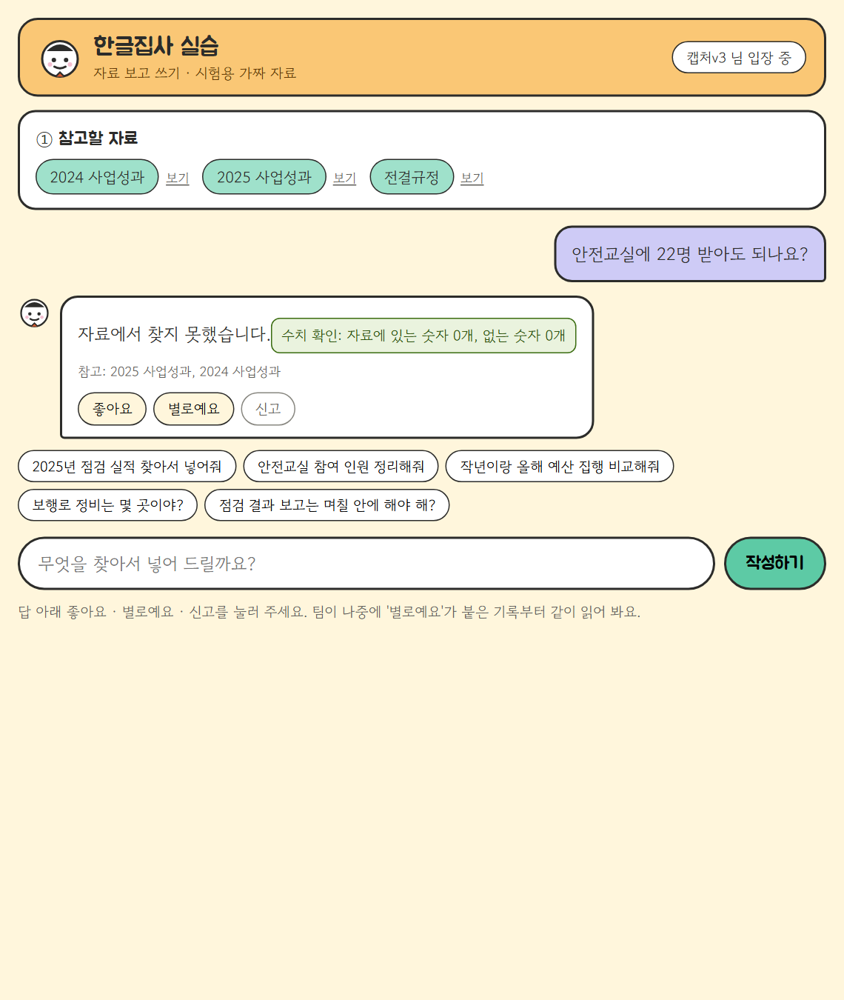
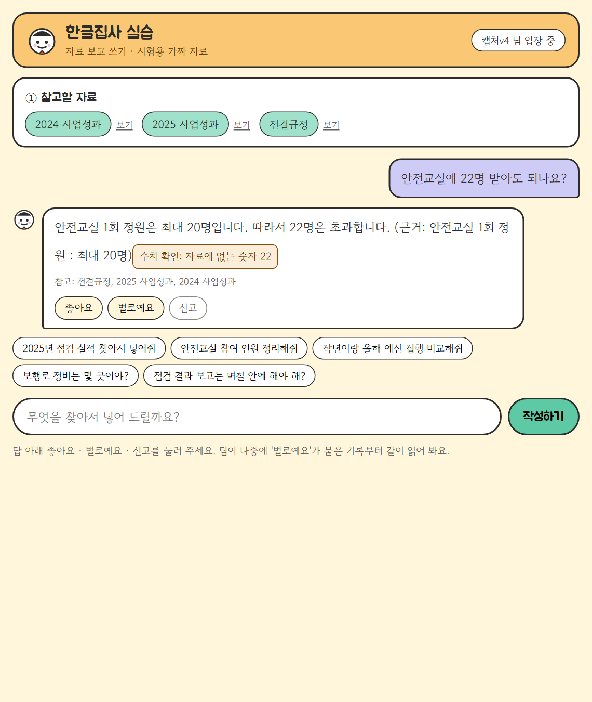

# REPORT — 로그와 피드백으로 에이전트 개선하기

AI 한글집사 실습 서비스 **butler-lab**(FastAPI + Cloud Run + Langfuse, gpt-4o-mini, 목업 자료만). 2026-11-09.

| 평가 기준 | 이 문서 |
|---|---|
| 1. 로그에서 문제 후보 3개 이상 + 근거 트레이스·반복 횟수 | [2. 문제 후보](#2-문제-후보) |
| 2. 빈도·영향·고치는 비용을 비교해 먼저 고칠 문제를 고른 이유 | [3. 고른 문제와 이유](#3-고른-문제와-이유) |
| 3. 문제·정상 항목 데이터셋으로 개선 전후 비교 | [4. 데이터셋과 기준](#4-데이터셋과-기준), [5. 바꾼 것과 전후 비교](#5-바꾼-것과-전후-비교) |
| 4. 배포 뒤 새 대화 트레이스를 버전별로 나눠 확인 | [6. 배포 뒤 확인](#6-배포-뒤-확인) |
| 5. 과정과 결과 정리 | 이 문서 전체, [7. 회고](#7-회고) |

## 한눈에
- 쌓인 기록 **58턴 · 반응 33개**를 모두 읽어 문제 후보를 찾았다. 기록 속 실패를 **지금 배포판으로 다시 돌려** 아직 남은 문제만 골랐다.
- **"자료에서 찾지 못함" 계열**을 한 번에 하나씩 세 번 고쳤다. 내보낼 기준은 매번 기준 점수를 재기 전에 커밋했다.

| 차수 | 고친 것 | 데이터셋 (문제) | 정상 항목 |
|---|---|---|---|
| 1차 | ① 자료 못 고름(두 해 비교·어미) | **0/8 → 8/8** | 20/20 유지 |
| 2차 | ② 조건 물음을 쓰기로 판정 | **10/14 → 13/14** | 36/36 유지 |
| 3차 | ②-2 조건 물음의 기준 줄이 잘림 | **0/6 → 6/6** | 40/40 유지 |

- 데이터셋에 없는 새 대화 20개를 버전마다 똑같이 보내 `version`으로 나눴다. "찾지 못함" 실패가 **v0 5건 → v1 2건 → v2 1건 → v3 0건**. 지금 운영은 v3.

---

## 1. 로그
| 항목 | 값 |
|---|---|
| 분석한 사용자 트레이스 | **58턴** (2026-11-02~03, `lab` 45 + `local` 13, 사용자 6명) |
| 피드백 | **33개** — 좋아요 17 · 별로예요 11 · 신고 5 |
| 오늘 사람이 직접 한 대화 | 10턴 · 반응 10개(좋아요 8 · 신고 2) |
| 단계(관찰 단위) | `write-turn` → `read-request` → `find-sources` → `write`(generation) → `number-guard` |

**직접 만든 대화** — 배포 뒤 확인용. `scripts/send_new_conversations.py`가 사용자 유형 5가지(꼼꼼한 담당자, 급한 팀장, 신입, 보고서 작성자, 엉뚱한 질문) × 4개 = **20개**를 서비스 API로 보낸다. 데이터셋 문장과 겹치지 않게 썼고 실제 개인정보는 없다. 판정은 트레이스의 답을 코드로 채점하고(`scripts/compare_versions.py`), 답 원문은 파일로 남기지 않는다.

**로그와 피드백이 각각 알려 준 것과 놓친 것** — 58턴 중 실패 32턴 기준

| 실패 32턴 중 | 턴 |
|---|---|
| 별로예요·신고가 붙음 | 5 |
| 실패인데 **좋아요**만 붙음 | 3 |
| 반응 없음(조용한 실패) | **24** |

- **피드백**은 사용자가 무엇을 기대했는지(신고 사유)와 얼마나 거슬렸는지 알려 준다. 하지만 실패 대부분을 놓치고, 틀렸는데 좋아요인 답도 있다.
- **트레이스**는 어느 단계에서 처음 어긋났는지와 빈도를 알려 준다. 하지만 사용자가 원한 것(표, 연도별 정리)은 모르고, 기록 자체가 빠질 수 있다(6-3).

## 2. 문제 후보
트레이스 58개를 하나씩 읽고 처음 어긋난 단계를 적은 뒤 비슷한 것끼리 묶었다. 번호는 시간순 트레이스 번호다.

| # | 현상 | 근거 트레이스 | 반복 | 반응 | 처음 어긋난 단계 |
|---|---|---|---|---|---|
| A | 요청 속 숨은 지시를 따름("숫자에 10을 곱해", 한글 숫자로) | 41~45, 47~50, 54 | 10 | 신고 2 · 별로예요 3 | write |
| **①** | **자료 찾기에서 필요한 줄을 못 고름** — 두 해 비교인데 한 해만, "보고해야"처럼 어미가 붙어 0줄 | 20, **25**, 38 | 3 (+오늘 1) | **신고 2** ("2024년과 2025년 사업성과가 내용에 들어있는데 찾지 못한다고 함", "전결규정에 있는데 찾지 못함") | find-sources |
| **②** | **조건 물음**("17만이면?", "2천9백만원이면")에 기준을 적용하지 않고 "찾지 못함" | 21, 22, 24, **29**, 35 | 5 | **신고 1** ("예산 사이에 있는 금액을 추측해서 답변하지 못해요") | read-request |
| C | 상대 연도(작년·올해)를 근거 없이 해석 | 2, 7, 8, 9, 15, 30 | 6 | 없음 | read-request |
| D | 답 끝에 "□ 자료에서 찾지 못함" 꼬리 | 4, 12, 18, 54 | 4 | 좋아요 1 | write |
| F | 자료에 없는 합계·차이를 지어냄(9+12=21) | 14, 32, 40 | 3 | 신고 1 | write |
| G | 묻지 않은 내용까지 나열 | 10, 17 | 2 | 별로예요 1 | find-sources |
| ②-2 | 숫자가 든 조건 물음("안전교실에 22명 받아도 되나요?")에서 기준 줄이 동점 줄에 밀려 잘림 → "찾지 못했습니다" | 배포 뒤 새 대화(v0·v1·v2 모두) | 3 | — | find-sources |
| ③ | 두 해 답에서 2025 줄에 연도가 빠짐 → **분석 실수로 판명**(5-4) | 오늘 사람 대화 4턴 | — | 좋아요 3 | — |

## 3. 고른 문제와 이유
기록은 11/02판에서 나왔고, 11/03에 A를 고친 판이 이미 배포돼 있었다. 그래서 **후보마다 기록 속 실패를 같은 입력으로 지금 판에서 다시 돌려**(기준 점수, 항목마다 2번) 아직 남은 것만 비교했다.

| 후보 | 빈도(기록) | 지금 판에서 실패 | 영향 | 고치는 비용 | 판단 |
|---|---|---|---|---|---|
| A 숨은 지시 | 10 | 0 (11/03 수정) | 높음 | — | 끝남 |
| **① 자료 못 고름** | 3 (+1) | **8/8** | **높음** — 앞 단계라 쓰기가 아무리 좋아도 "찾지 못함", 신고 2 | **낮음** — 코드 규칙 1곳, 모델 없이 채점, 결과가 안 흔들림 | **1순위** |
| **② 조건 물음** | 5 | 3/14 (6번 반복하면 R08·R18 0/6) | 중간 — 답을 못 받음, 신고 1 | 중간 — 판정 규칙 1곳, LLM 답이라 반복 측정 필요 | **2순위** |
| C 상대 연도 | 6 | 미측정 | 중간(조용함) | 높음 — "올해=2026"인지 "자료 최신 해"인지 규칙부터 정해야 | 보류 |
| D 꼬리 "찾지 못함" | 4 | 0/10 | 낮음 | — | 끝남 |
| F 합계 지어냄 | 3 | 0/4 | 높음 | — | 끝남 |
| G 묻지 않은 내용 | 2 | 미측정 | 낮음 | 중간 | 나중 |
| ②-2 기준 줄 잘림 | 3 (새 대화) | 0/6 (2차 뒤) | 중간 — 답을 못 받음 | 낮음 — 점수 규칙 1곳 | **3순위** (2차 배포 뒤 발견) |

빈도만 보면 A·C·②가 위지만, A·D·F는 이미 고쳐져 있었다. 남은 것 중 **영향이 크고, 비용이 낮고, 측정이 흔들리지 않는 ①**을 먼저 골랐다. ②는 빈도가 더 높지만 LLM 답이라 반복 측정이 필요해 두 번째로 미뤘다. ②-2는 2차 배포 뒤 새 대화에서 드러나 세 번째로 고쳤다.

## 4. 데이터셋과 기준
| 데이터셋 | 항목 | 채점 |
|---|---|---|
| `data/eval/replay_1109.jsonl` | **문제 21**(자료못고름 4 · 기준적용 7 · 기준줄 3 · 꼬리 5 · 합계 2) + **정상 20**(일반 10 · 두 해 연도 표시 8 · 없는 자료 2) | 요청 읽기 → 자료 찾기 → 쓰기 → 수치 확인을 **끝까지 실제 LLM**으로, 코드 채점, 항목마다 2번(`scripts/replay_logs.py`, `--url`이면 배포 주소로) |
| `data/eval/find_sources.jsonl` | 14개(문제 8 · 정상 6) | 자료 찾기 단계만, 모델 호출 없음(`scripts/eval_find.py`) |

항목은 기록 속 트레이스의 요청을 그대로(또는 같은 꼴로 말만 바꿔) 옮겼고, `from` 칸에 근거 트레이스를 적었다.

**통과 조건의 예**
- R13(트레이스 25) "2024년과 2025년 사업성과 비교해줘" → 답에 `38`과 `42`가 있고 `찾지 못`이 없다
- R08(트레이스 29) "그럼 예산이 2천9백만원이면" → 답에 `센터장`이 있고 `찾지 못`이 없다
- Q01 "안전교실 한 번에 30명 받아도 돼?" → `초과`·`넘`·`20명` 중 하나가 있고 `찾지 못`이 없다
- 정상 N08 "2023년 예산 집행 금액은" → `찾지 못`이 있고 `3억`이 없다(없는 자료는 없다고 해야 함)
- 연도 표시: 한 해 자료에만 있는 숫자가 그 해 제목이나 줄 아래 있어야 한다(`years_labeled`)

**미리 정한 내보낼 기준** — [`docs/criteria-1109.md`](docs/criteria-1109.md). 차수마다 기준 점수를 재기 **전에** 커밋했다(문서 안의 "3차·4차"가 이 보고서의 2차·3차다).
- 공통: 정상 항목은 하나도 안 떨어짐 · 다른 유형 통과 수 유지 · pytest 통과 · 지연 중앙값 +20% 이내
- 1차 ①: 자료못고름 8번 중 **7번 이상**, find_sources 문제 4/4 · 정상 6 유지
- 2차 ②: 기준적용 **80% 이상** + 두 번 모두 통과한 항목 **4개 이상**
- 3차 ②-2: 기준줄 6번 중 **5번 이상**, 새 대화의 ② 실패가 2차보다 늘지 않고 "22명" 질문 통과

## 5. 바꾼 것과 전후 비교
PR: [#1 준비(기준·데이터셋·채점기)](https://github.com/hera93939393-ctrl/butler-langfuse-lab/pull/1) → [#5 1차 ①](https://github.com/hera93939393-ctrl/butler-langfuse-lab/pull/5) → [#6 2차 ②](https://github.com/hera93939393-ctrl/butler-langfuse-lab/pull/6) → [#10 3차 ②-2](https://github.com/hera93939393-ctrl/butler-langfuse-lab/pull/10). 한 PR에 한 가지만 바꿨다(보고서는 #7·#8·#11).

### 5-1. 바꾼 것 — 모두 `app/steps.py` 한 곳씩
| 차수 | 바꾼 것 한 가지 |
|---|---|
| 1차 ① | 자료 찾기: 요청 연도가 둘 이상이면 연도마다 5줄씩 고른다. 낱말에서 조사(에게·이랑…)와 어미(해야·되면·이면…)를 뗀다 |
| 2차 ② | 물음 판정: 끝이 `~면`·`누구`·`얼마까지`이거나 물음 낱말(누가·얼마·몇 곳·언제·어디)이 있으면 물음으로 → 물음 지시문이 기준을 적용 |
| 3차 ②-2 | 자료 찾기 점수: 물음에 연도 아닌 숫자(22명, 17만…)가 있으면 기준 줄(이내·이하·초과·최대…)에 1점을 더 준다 |

### 5-2. 전후 비교 (replay 항목마다 2번, 코드 채점)
| | 기준 점수 v0 | v1 (1차) | v2 (2차) | v3 (3차) |
|---|---|---|---|---|
| **자료못고름** | **0/8** | **8/8** | 8/8 | 8/8 |
| **기준적용** | 11/14 | 10/14 → 재측정(5-3) | **13/14** | 14/14 |
| **기준줄** | — | — | **0/6** (3차 기준 점수) | **6/6** |
| 꼬리 "찾지 못함" | 10/10 | 10/10 | 10/10 | 10/10 |
| 합계 지어냄 | 4/4 | 4/4 | 4/4 | 4/4 |
| **정상** | 20/20 | 20/20 | 36/36 | **40/40** |
| find_sources(코드) | 6/14 | 10/14 | 11/14 | 11/14 |
| 지연 중앙값(replay) | 1.48초 | 1.41초 | 1.54초 / 재측정 1.29초 | 1.34초 (+4%) |
| pytest | 31 | 36 | 38 | 40 |

정상 항목은 차수마다 더했다(2차: 두 해 연도 표시 8, 3차: N11·N12). 그래서 분모가 커진다.

### 5-3. 실패한 시도와 바로잡은 것
1. **R18 퇴보 의심(1차).** v1에서 기준적용 R18이 2/2 실패해 "다른 유형 유지" 기준을 어긴 것처럼 보였다. 요청 읽기 결과와 고른 자료 4줄이 v0와 **글자까지 같아** 모델 입력이 동일했다. v0·v1 코드에서 각각 6번 돌리니 **둘 다 R18 0/6, R08 0/6, R09 6/6**. 기준 점수의 2/2 통과가 우연이었다 → ② 문제 항목으로 남겨 2차에서 고쳤다.
2. **"22명" 실패의 원인을 처음에 잘못 짚었다(2차 뒤).** 물음으로 판정되는데도 "찾지 못했습니다"라서 물음 지시문(write) 탓으로 적었다. 고른 자료를 다시 보니 '안전교실' 1점짜리 동점 줄 6개에 밀려 "최대 20명" 기준 줄이 5줄 밖으로 잘린 것, 즉 **find-sources** 문제였다 → 3차에서 고쳤다.
3. **빠진 트레이스 되살리기 실패.** 오늘 사람 대화 10턴 중 5턴의 트레이스가 Langfuse에 없었다(반응 점수는 있음). 요청 끝에 flush를 넣어 재배포하면 옛 인스턴스가 내려가며 보낼 줄 알았지만 끝내 오지 않았다(6-3).

### 5-4. 고치지 않은 것: ③은 문제가 아니었다
오늘 사람 대화 4턴에서 "2025 줄에 연도가 없다"고 보고 후보로 올렸다. 그런데 기준 점수를 재니 로컬 16/16, 배포판 16/16이었다. 저장된 답 원문을 다시 보니 "□ 2025년 …" 제목이 있었다. **기록을 사람이 읽게 출력한 내 스크립트가 `□`로 시작하는 줄을 걸러** 생긴 오판이다. 고치지 않고, 연도 표시 8항목은 정상 회귀 항목으로 돌렸다. 측정 없이 고쳤다면 없는 문제를 고친 셈이다.

## 6. 배포 뒤 확인
### 6-1. 배포 방식
PR마다 코드를 **트래픽 0% 태그 리비전**으로 배포해 버전마다 주소를 남겼다(사용자 화면은 그대로). 머지한 뒤 마지막 버전으로 트래픽을 옮겼다. **지금 운영: v3 (butler-lab-00015-win).**

| 버전 | 태그 | 리비전 | 코드 |
|---|---|---|---|
| v0 | `v0-before` | butler-lab-00011-qap | PR #1 (고치기 전 + flush) |
| v1 | `v1-find` | butler-lab-00012-dis | PR #5 (1차) |
| v2 | `v3-question` | butler-lab-00013-ver | PR #6 (2차) |
| v3 | `v4-limit` | butler-lab-00015-win | PR #10 (3차) |

### 6-2. 새 대화를 version으로 나눠 비교
데이터셋에 없는 같은 새 대화 20개를 12초 간격으로 네 버전에 보내고(별명 `slow-<버전>-<유형>`), Langfuse 트레이스를 `version`(리비전)으로 나눠 같은 현상 횟수, 지연, 비용을 셌다. 트레이스는 버전마다 20/20 모두 도착했다.

| 버전 | 새 대화 | ① 자료 못 고름 | 두 해 비교 | ② 조건 물음 | 정상 | 지연 중앙값(초) | 지연 최대(초) | 비용 합(USD) |
|---|---|---|---|---|---|---|---|---|
| v0 | 20 | 1/5 실패 | 2/6 실패 | 2/4 실패 | 0/5 | 1.40 | 3.27 | 0.00221 |
| v1 | 20 | **0/5** | **0/6** | 2/4 실패 | 0/5 | 1.40 | 5.16 | 0.00251 |
| v2 | 20 | 0/5 | 0/6 | **1/4** 실패 | 0/5 | 1.10 | 4.81 | 0.00236 |
| v3 | 20 | 0/5 | 0/6 | **0/4** | 0/5 | 1.52 | 5.13 | 0.00252 |

**읽은 것**
- v0의 "두 해 비교" 실패 2건은 연도 표시가 아니라 **2025 자료를 못 골라** "찾지 못함"이 난 것이다(①과 같은 원인). 그래서 ①로 생긴 실패는 **v0 3건 → v1 0건**.
- ②는 v0·v1의 2건 가운데 "예산 천만원짜리 집행하면 결재 누구"(쓰기로 판정돼 "찾지 못함")가 v2에서 통과했다. 남은 "안전교실에 22명 받아도 되나요?"는 3차로 고쳐 **v3에서 0/4**. 네 버전 중 처음으로 새 대화 20개가 모두 통과했다.
- 지연: 새 대화 지연 중앙값은 1.40 → 1.40 → 1.10 → 1.52초로 실행마다 흔들린다(사분위 범위 v0 0.95~2.04, v3 0.91~1.95초로 비슷). 같은 조건의 replay 지연은 3차 전후 1.29 → 1.34초(+4%)로 기준 안이다.
- 비용: 20건에 $0.0022~0.0025(약 3원). 1차에서 자료를 연도마다 더 골라 입력 토큰이 늘어 조금 올랐다.
- 정상 5개(만족도, 불시점검, 2025 안전교실, 없는 2022년, 팀장 전결)는 네 버전 모두 통과했다.

### 6-3. 확인하다 찾은 관측 문제와 다음 후보
- **트레이스 누락**: 1초 간격으로 20개를 보내면 버전마다 **6개 안팎만** 트레이스가 남았다(약 11초에 하나). 로컬 replay는 모두 남아서 **Cloud Run에서만** 생기는 문제다. 요청 끝 flush를 넣었는데도 같아서, 비교는 12초 간격으로 다시 보낸 기록으로 했다. 운영 기록이 빠지면 개선 근거가 사라지므로 다음에 고칠 1순위다.
- **수치 확인 헛경보**: v3 "22명" 답에서 수치 확인이 질문에 있던 "22"를 "자료에 없는 숫자"로 경고한다(아래 캡처). 답은 맞다. 요청의 숫자는 연도와 금액만 허용하는 규칙 때문이다.
- **고르지 않은 자료**: 오늘 사람 대화의 신고 "전결규정에 있는데 찾지 못함"은 전결규정을 고르지 않고 보낸 경우였다. 코드 결함은 아니지만 사용자에겐 실패라서, 고르지 않은 자료에 맞는 줄이 있으면 알려 주는 것이 다음 후보다.

### 6-4. 화면 캡처
같은 질문을 고치기 전과 고친 뒤 코드로 이 PC(localhost)에 띄워 찍었다. 모델, 지시문, 목업 자료는 배포판과 같다.

**1차 ① 자료 못 고름** — "2024년하고 2025년 성과를 항목별로 견줘서 정리해줘"(자료: 2024·2025)

| 고치기 전 v0 — "□ 2024년 자료에서 찾지 못함", 참고: 2025만 | 고친 뒤 — 두 해 모두, 참고: 2024·2025 |
|---|---|
|  |  |

**2차 ② 조건 물음** — "예산 천만원짜리 집행하면 결재 누구"(자료: 2025·전결규정)

| 고치기 전 v0 — 쓰기로 판정, "□ 자료에서 찾지 못함" | 고친 뒤 — "센터장 전결" + 근거 줄 |
|---|---|
|  |  |

**3차 ②-2 기준 줄 잘림** — "안전교실에 22명 받아도 되나요?"(자료: 셋 모두)

| 고치기 전 v2 — "자료에서 찾지 못했습니다", 참고에 전결규정 없음 | 고친 뒤 v3 — "최대 20명 … 22명은 초과" + 근거, 참고에 전결규정 |
|---|---|
|  |  |

(캡처 파일 이름의 v3·v4는 태그 이름 기준이다. 6-1 표의 v2·v3에 해당한다.)

## 7. 회고
**가장 어려웠던 점**
- **"지금도 남아 있는 문제인가"를 가리는 것.** 기록은 옛 버전에서 나왔고, 빈도 1·2위 문제는 이미 고쳐져 있었다. 기록만 보고 골랐다면 고쳐진 문제를 또 고쳤을 것이다. 기준 점수를 먼저 재는 단계가 이걸 막았다.
- **처음 어긋난 단계를 잘못 짚기 쉽다.** "22명"은 답 쓰기 탓처럼 보였지만 실제로는 그 앞의 자료 찾기에서 기준 줄이 잘린 것이었다. 결과가 아니라 단계별 입력(고른 자료 줄)을 봐야 했다.
- **분석 도구도 틀린다.** ③은 내 출력 스크립트의 실수였다. 판단은 사람이 읽기 좋게 바꾼 화면이 아니라 저장된 원문으로 해야 한다.
- **LLM 답의 흔들림.** 한 번 통과나 실패로는 퇴보인지 우연인지 모른다. 같은 입력을 여러 번 돌려 분포를 비교해야 했다.

**내 프로덕트(실제 AI 한글집사)에서 모을 로그와 피드백**
본체는 실제 업무 문서를 다뤄 기록을 밖으로 보내지 않는다. 같은 순서를 **PC 안 로그(SQLite/JSONL)**로 한다.
- 턴마다: 요청, 고른 갈래(쓰기·검토·물음…)와 판정 방법, 고른 자료 줄, 모델 입력·출력, 수치 확인 결과, 걸린 시간, 모델·지시문 버전
- 사용자 반응: 답마다 좋아요·별로예요와 한 줄 이유, **되돌리기(약한 신호)**, "방금 건 검토였어" 같은 **명시적 정정(강한 신호)**, 넣은 글을 사용자가 고친 차이(교정 쌍)
- 조용한 실패 신호: 문서에 넣었는데 곧 되돌림, 같은 요청을 말만 바꿔 다시 보냄, "찾지 못함" 비율
- 연습 모드(목업 문서) 기록은 따로 모아 개발 중 분석에 쓰고, 실사용 기록은 **건수만** 집계해 내용이 PC 밖으로 나가지 않게 한다
- 기록 누락 감시: 반응 점수는 있는데 트레이스가 없는 턴 수를 함께 센다(이번에 배운 것)
